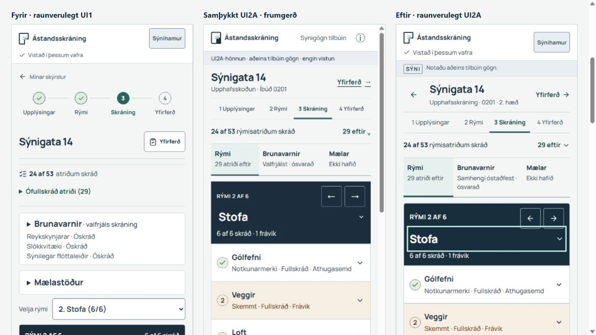

# UI2A · Innleiðing Skráningarskjás til óháðrar rýni

**Aðeins Draft PR · engin sameining eða birting.** Samþykkt hönnun úr [UI2A-rýninni](../../ui2a/REVIEW.md) og [óbreyttu frumgerðinni](../../ui2a/prototype/index.html) er innleidd í raunverulega appið.

## Grunnur og afmörkun

GitHub main var staðfest með `git ls-remote origin refs/heads/main`: `96e5150c2cba36378928caf8219e5aebfbee6d79`. Tré þess commits var staðfest sem `b18a0c2d895913f3415953a08a1f1a02eff01055`, óbreytt frá samþykktum grunni. Nýtt vinnutré var stofnað af þeim grunni og ný grein, `codex/ui2a-mobile-inspection`, notuð.

Vinnutré: `C:/Users/Danni/.codex/worktrees/ui2a-mobile-implementation/Ástandskoðun`. Aðalvinnumappan, fyrri hönnunarvinnan og Docker/D1-vinnutré PR #19 voru ekki notuð til breytinga. Samþykkt hönnunargögn voru afrituð óbreytt í `docs/ui2a/` svo þau fylgi rýni; ZIP-afrit fyrri afhendingar er ekki hluti kóðabreytingarinnar.

`docs/ui2a/.gitattributes` varðveitir upprunalega bæti hönnunargagnanna við Git-afgreiðslu. SHA-256-samanburður við fyrri afhendingu er í `evidence.json`.

## Það sem breyttist

- Einn þéttur eignarhaus og fjögur númeruð skref. Fyrri skref fá ekki hak sem mætti túlka sem staðfest fullgerð gögn.
- Samantekt segir sérstaklega **„rýmisatriðum skráð“**. Ósvarað og ófullskráð rýmisatriði nota áfram `itemProgress` og `missingAnswers`. Brunavarnir og mælar hafa sjálfstæða stöðu og eru ekki felld í sameiginlega fullgerðartölu.
- Stika með **Rými / Brunavarnir / Mælar** helst við efri brún við venjulega flettingu. Hún opnar fyrirliggjandi kafla í einni aðgerð. Kaflarnir haldast allir á síðunni.
- Rýmisheiti, innbyggt rýmisval, fyrra/næsta og ein stöðulína eru sameinuð. Heiti getur brotnað yfir línur; engin stytting með ellipsis er notuð. Þéttur UI1/A2.2-gátlisti og ritlar haldast.
- Brunavarnir og mælastöður eru á eftir rýmisgátlistanum. Endurkomutengill og Rými-tengill stikunnar færa fókus aftur í sama lifandi rýmisritil.
- Fyrsta heimsókn án beiðni eða varðveittrar staðsetningar getur byrjað við þéttan síðutopp. Varðveitt staðsetning, skýr djúptengill og leiðrétting ráða áfram markstað. Ef markstaður er þegar sýnilegur er engin ástæða til að þvinga nýja pixlastöðu.
- Apphaus notar áfram **raunverulegan `SaveStatus`**. Sýnihamstexti er styttur á Skráningu, en hjálp, villur, bið, viðvaranir og endurheimtaraðgerðir eru varðveittar.

## Nákvæm skráabreytingaskrá

Heildarlisti hverrar skráar, þar á meðal gagna og skjámynda, er í [file-inventory.json](file-inventory.json). Keyrslukóði:

| Skrá | Tilgangur |
|---|---|
| `src/components/screens/inspection-screen.tsx` | Eignarhaus, skref, rýmisframvinda, stika, rýmisstýring og ný röðun fyrirliggjandi eininga. |
| `src/components/inspection-screen.module.css` | Afmarkaðir UI2A-stílar, þétt rýmisbirting, snertifletir, skrunbil og fókusrammar. |
| `src/components/inspection-section-status.ts` | Orðuð birting á niðurstöðum núverandi fire/meter-hjálpara; engin ný fullgerðisregla. |
| `src/components/use-inspection-sections.ts` | DOM-leiðsögn, síðasti rýmisfókus, virk staðsetning, mæld hæð stiku og aðlögun að sjónsvæði. Engin breyting á URL eða skráningargögnum. |
| `src/components/inspection-focus.ts` | Birtir spurningarhóp ásamt völdu svari við leiðréttingu þegar hann rúmast; heldur fókus á raunverulegu stýringunni. |
| `src/components/use-inspection-navigation.ts` | Afmarkað frávik fyrir fyrstu, ferska komu. Uppruna-, staðsetningar- og varðveislusamningur helst. |
| `src/components/use-fire-correction.ts` / `use-meter-correction.ts` | Nota sameiginlega skrunhjálp. Slóðaval, auðkenni, fallback og fókusmark eru óbreytt. |
| `src/components/app-shell.tsx` / `src/app/globals.css` | Skráningarsértæk samþjöppun hauss. Vistunarstaða og viðvaranir eru ekki endurskrifaðar. |

Prófunar- og rýniskrár:

| Skrá | Tilgangur |
|---|---|
| `tests/ui2a-inspection.spec.ts` | Stöður, fyrsta koma/áframhald, fókus, myndainntak, afturköllun, óstaðfest mælatilgangsskipti og leiðréttingarferðir. |
| `tests/ui2a-capture.spec.ts` | Raunverulegar myndir og mælingar úr óbreyttu main og framleiðslubyggðri innleiðingu við allar þrjár stærðir. |
| `tests/inspection-accessibility.ts` | Allt Axe-reglusettið ásamt skráðri endurmælingu snertiflata sem liggja bak við fasta stiku. Engin regla er slökkt. |
| `tests/fire-observations-capture.spec.ts` / `inspection-evidence.spec.ts` / `meter-readings-capture.spec.ts` | Nota aðgengisskimun sem tekur tillit til nýrrar fastrar stiku; fyrri efnis- og varðveislupróf haldast. |
| `tests/inspection-checklist.spec.ts` | Tveir framvindu-selectorar uppfærðir fyrir nýja samantekt. Sömu væntu tölur. |
| `tests/rental-information-capture.spec.ts` | Fer í Yfirferð eftir aðgengilegu heiti skrefs í stað CSS-klasa gömlu skrefabirtingarinnar. Sömu myndavarðveislu- og leiðréttingarfullyrðingar. |
| `playwright.ui2a.config.ts` | Sama heila venjulega prófasvítan á sér loopback-porti; sértækt úttak til að rekast ekki á aðra vinnu. |
| `eslint.config.mjs` | Fryst, myndað hönnunarviðmið undir `docs/ui2a/` undanskilið lint. Keyrslukóði og ný próf eru lint-prófuð. |
| `docs/ui2a/**` | Samþykkt hönnunarviðmið úr fyrri afhendingu, óbreytt. |
| `docs/qa/ui2a-implementation/**` | Þessi skýrsla, samanburðarsafn, uppruni, mælingar og sannprófunargögn. |

## Stöður og gagnavarsla

`fireState` og `fireGroupStatus` ráða áfram annmörkum, ósvaraðri/ófullskráðri skráningu og takmörkunum. Í leiguskoðun með engin svör segir stikan „3 flokkar ósvaraðir“. Utan leigusamhengis er valfrjáls skráning merkt þannig. Ef leigusamhengi er ekki staðfest stendur **„Samhengi óstaðfest“** við stöðuna; það verður ekki staðfest valfrjáls eða fullgerð leiguskoðun.

`meterState`, `meterUtilityStatus` og `activeMeterPurpose` greina óvirka skráningu, óvalda valfrjálsa hluta, vantað svar, yfirferðar-/staðfestingarþörf, takmarkanir og varðveitt gögn. „Ekki hafið“ merkir ekki að mælahlutanum sé lokið. „Álestrar skráðir“ er aðeins notað þegar núverandi veitustöður styðja það; það er ekki heildarhak yfir eignina.

Fyrirliggjandi matslíkön, validation, ástand, virkni, þrif, skaðalýsingar, örugg staðfesting fráviksbreytinga, takmörkuð afturköllun, ljósmyndir, hitaskráning, tengdar skoðanir, samanburður og skýrsluforskoðun voru ekki endurhönnuð. [evidence.json](evidence.json) skráir varðveisluskoðun á viðkomandi upprunaskrám.

Hlutastikan notar eingöngu fyrirliggjandi DOM. Hún kallar ekki `navigation.activate`, breytir ekki query/hash, skrifar ekki geymslu og velur ekki nýja React-lykla. Prófin merkja lifandi myndainntak og mælatilgangsforskoðun og staðfesta að sama DOM-eintak, blob-URL, afturköllun og óstaðfest forskoðun haldist yfir hlutaferðir.

Rýmisleiðir halda `rymi/atridi/fra/yfirferdRymi/yfirferdAtridi`. Brunavarnir halda `hluti/flokkur/rad/reitur/fra`; mælar halda `maelar/maelaReitur/fra`. Engum almennum nýjum query-lykli er bætt á sérleiðir. Leiðréttingar fara aftur að fyrirliggjandi markstað í Yfirferð.

## Sjónrænn samanburður

[Opna þriggja dálka samanburðinn](index.html): raunverulegt main → samþykkt UI2A-frumgerð → raunveruleg innleiðing. Þetta ber innleiðinguna beint saman við samþykkta viðmiðið.



Til að skoða gagnvirka myndasafnið má keyra `node docs/qa/ui2a-implementation/serve.mjs` úr rót vinnutrésins og opna `http://127.0.0.1:3223/qa/ui2a-implementation/`. Þetta er lesþjónn á loopback fyrir rýniskrár; hann ræsir hvorki app né gagnagrunn. Stöðva með Ctrl+C. Eldri `docs/ui2a/validate.mjs` sannprófar upprunalegu hönnunarlotuna á óbreyttum grunni og á ekki við innleiðingargreinina; ný `collect-evidence.mjs` safnar lokagögnum innleiðingarinnar.

<!-- METRICS:start -->
| Skjár | Fyrir | Eftir | Minna bil að fyrstu röð |
|---|---:|---:|---:|
| 360 × 800 | 773 px | 539 px | 234 px (30%) |
| 390 × 844 | 773 px | 518 px | 255 px (33%) |
| 1440 × 1000 | 781 px | 531 px | 250 px (32%) |
<!-- METRICS:end -->

Mælingar vísa til sama sýnirýmis, Stofu í Sýnigötu 14, við síðutopp. Ekki er fullyrt að skoðunartími eða heildarsíðuhæð hafi styst um sömu prósentu. Núverandi main hoppar þegar að rými á síma; þess vegna eru **fyrsta lending og áframhald líka sýnd sérstaklega**.

Raunverulega innleiðingin hefur raunverulega vistunarstöðu, fullan texta um einingu/hæð, 44 px bakleið í skýrslur og sýnilegt óstaðfest leigusamhengi. Það skýrir hæðarmun frá einfaldari frumgerðinni. Petrol/navy/teal, þéttar UI1-raðir og sjálfstæðir kaflar halda samþykktri stefnu.

Á desktop heldur innleiðingin núverandi breidd appskeljar og fyrirliggjandi stöðuvísum rýmislistans. Frumgerðin hafði þrengri efnisbreidd og einfaldari lista. Þetta sést beint í 1440 px samanburðinum; matsraðirnar nota áfram upprunalega UI1-stílinn.

Myndasafnið nær yfir fyrstu komu, áframhald, fullskráð frávik, ósvarað/ófullskráð, áskilið brunavarnamat í leiguskoðun, óvirka/valfrjálsa/virka mæla, leiðréttingu/endurkomu og 320 CSS px/Tab. PNG-myndir appsins eru teknar beint í Playwright við uppgefna viewport-stærð; engin mynd er lagfærð eftir myndatöku. Samþykktu JPEG-viðmiðin eru upprunaleg útflutningsgögn fyrri hönnunarlotu.

## Sjálfvirk sannprófun

<!-- RESULTS:start -->
**1000 próf stóðust · 35 sleppt samkvæmt skilyrðum · 0 mistókust · lint, typecheck og build stóðust.** Heildartími: 16.0 mínútur. Nýju UI2A-prófin: 18/18 stóðust. Myndalotur: 3/3 fyrir og 3/3 eftir; 120 raunverulegar appmyndir. [Prófaskrá og sleppingar](test-results.json) · [Heildarúttak](full-suite.txt) · [Skráðar Axe-endurmælingar](accessibility-resampling.json).
<!-- RESULTS:end -->

Skipanir:

```text
npm run lint
npm run typecheck
npm run build
npx playwright test --config playwright.ui2a.config.ts --workers=2
```

`playwright.ui2a.config.ts` erfir öll venjuleg próf og öll þrjú verkefni úr upprunalegu `playwright.config.ts`, en notar sérportið 3222. Heildarlotan keyrir á `next start`, ekki breytilegri dev/HMR-keyrslu. Sérstakar C1/H1A/H1B-bakendastillingar eru eins og áður utan sjálfgefinnar svítu og voru ekki ræstar; enginn Supabase-, Docker- eða hýstur innviðaprófhamur var opnaður.

Lesanlegar `.txt`-úttaksskrár samræma aðeins línuskipti og fjarlægja bil aftast á línum. Upprunaleg keyrsluúttök haldast undir `artifacts/ui2a/` í vinnutrénu.

Myndalotur nota `UI2A_CAPTURE_PHASE=before|after`, með óbreyttu main á 3224 og innleiðingu á 3222. Gögnin eru sömu tilbúnu skýrslurnar í aðskildum vafrasamhengjum.

Fyrstu þróunarlotur fundu yfirlag rýmisvalmyndar á desktop, fókus-/skrunmál við spurningarhópa og Axe-snertiflata undir stikunni. Þær voru notaðar til viðgerðar, ekki sem lokasannprófun. Tvær fyrstu lotur deildu úttaksslóð; þeim var hætt og lokagögn nota aðskildar slóðir.

Fyrri heildartilraun var stöðvuð eftir þrjú frávik: tvítekinn „Aftur í yfirferð“-tengil, úreltan CSS-selector í leiguferlisprófi og mælaúttekt sem þurfti sömu skráðu endurmælingu og aðrar stikuúttektir. Tvítekna bakleiðin var fjarlægð; ein skýr bakleið er í eignarhaus og fyrirliggjandi leiðsögn neðst helst þar sem hún á við. Viðkomandi endurpróf stóðust 25/25, með tveimur skilyrtum sleppingum á endurteknu fjölstærðaprófi. Síðan var öll svítan ræst að nýju. „Við síðutopp“-myndir voru einnig endurteknar með tafarlausu skruni og staðfestingu fyrir/eftir myndatöku; þær byggja ekki á óloknu sjálfvirku Home-skruni.

### Hvernig aðgengisskimunin með stikunni er framkvæmd

Allt fyrra Axe-reglusettið keyrir áfram. Ef `target-size` greinir stýringu sem er geometrískt bak við föstu stikuna er **hverri slíkri stýringu flett í sýn og sama reglusettið keyrt aftur á hana**. Upprunaleg lýsing og endurprófun fylgja viðhengi `sticky-target-size-resampling`. Önnur frávik eða snertiflötur sem stenst ekki endurmælingu falla áfram. Engin regla er slökkt og engin hörð undanþága er sett fyrir ákveðinn ritil.

Fókus er sannprófaður sérstaklega við raunverulega staðsetningu, meðal annars með Tab og Shift+Tab í báðar áttir. Staðsetning og fókus endurheimtast eftir tímabundna Axe-endurmælingu svo skjámyndir og áframhald breytist ekki vegna skimunarinnar. Þetta er prófunaraðlögun vegna fastrar stikunnar, ekki fullyrðing um að allar yfirlagningar séu hættulausar.

Stikan losnar úr fastri stöðu þegar texti stækkar eða sjónsvæði verður stutt; sömu tenglar haldast í síðuflæði. Sú nálgun samræmist [W3C C34](https://www.w3.org/WAI/WCAG21/Techniques/css/C34). Fókusvörn beinist að því að höfundarsett yfirlag hylji ekki valda stýringu; sjá [W3C F110](https://www.w3.org/WAI/WCAG22/Techniques/failures/F110.html).

## Óútkljáð atriði og takmörk

- Engin fullyrðing um WCAG 2.2 AA-samræmi. Sjálfvirk skimun og hermt lyklaborð duga ekki til slíkrar staðfestingar.
- Raunverulegur sími, skjálesari, vafraaðdráttur, símatakkaborð, myndavél/myndasafn og notendarýni skoðunarmanns eru enn útistandandi. 200% textahermun og 320 CSS px eru afmörkuð vafrapróf.
- Aðlögun að `visualViewport` er til staðar, en hún kemur ekki í stað raunverulegrar iOS-/Android-prófunar.
- Cross-tab concurrency er áfram óleyst. Engin samstilling, ný flipalæsing eða breyttur vistunarsamningur bættist við.
- Myndir eru áfram tímabundnar sýni-forskoðanir. Appið er ekki samþykkt fyrir raunveruleg viðskiptavinagögn eða framleiðslunotkun.
- Hosted Gate C er **CLOSED**. Gate E / PUBLIC TEMPORARY er **UNRESOLVED**.

**Stöðvað fyrir óháða rýni.** Aðeins Draft PR er opnuð. Engin sameining, deployment eða breyting á PR #19, D1, Docker, Supabase, Auth, migrations, persistence eða hýsingu.
